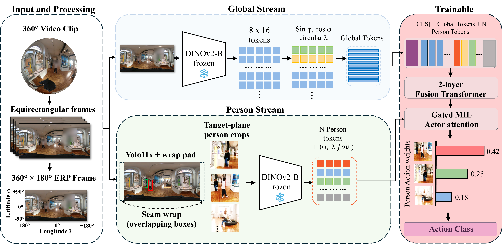
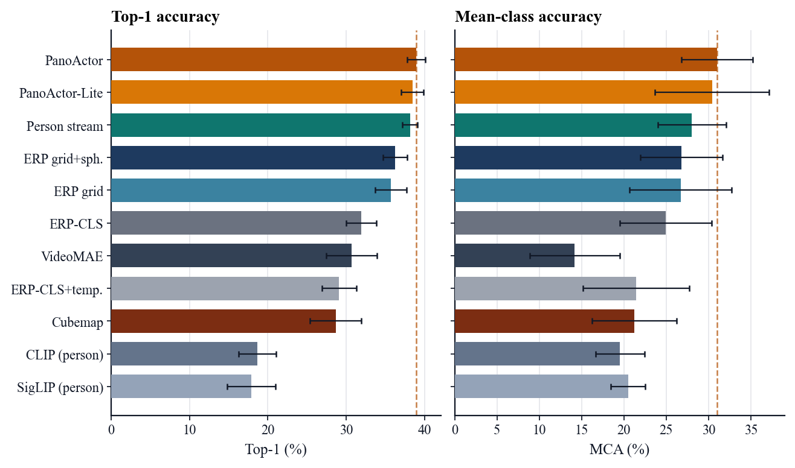
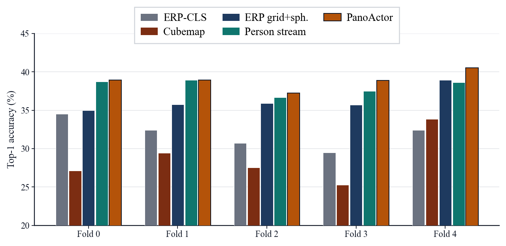
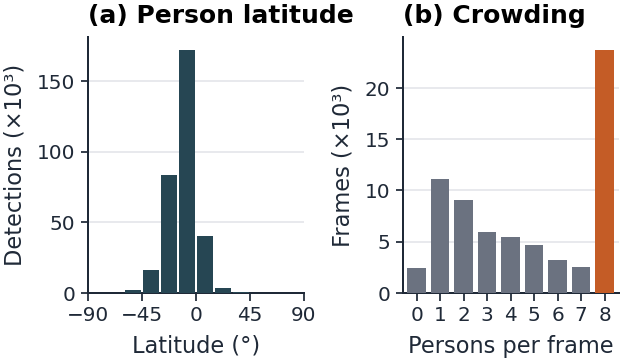
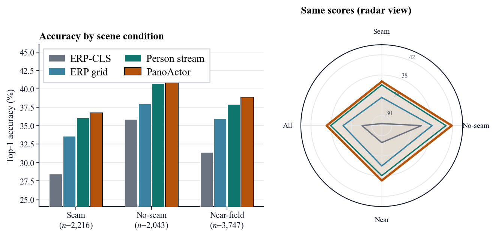
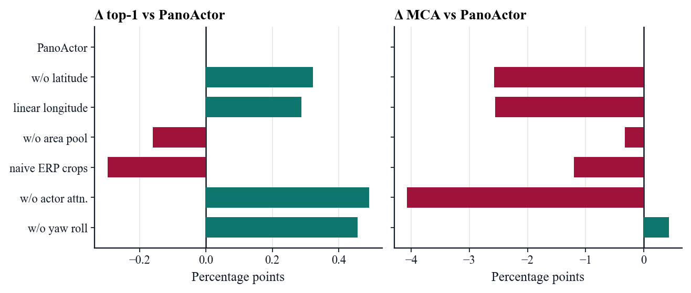
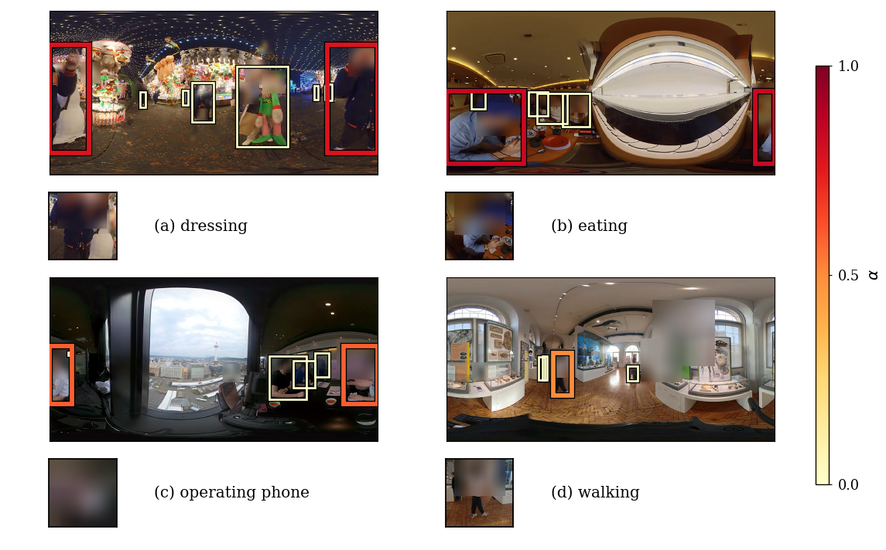

# PanoActor360

**Person-centric action recognition in 360° panoramic video.**

PanoActor360 finds the right actor in a crowded equirectangular (ERP) scene—where people wrap across the seam, appear at extreme scale, and a single clip label does not say *who* performed the action.

<p align="center">
  
</p>

<p align="center">
  <b>38.9%</b> top-1 &nbsp;·&nbsp; <b>31.0%</b> MCA &nbsp;·&nbsp;
  <b>+7.0</b> vs ERP-CLS &nbsp;·&nbsp; <b>+10.3</b> vs cubemap &nbsp;·&nbsp;
  wins on <b>5/5</b> folds &nbsp;·&nbsp; <b>2.4M</b> trainable params
</p>

Protocol on **360+x**: **4,259** clips · **27** classes · **231** videos · **5-fold** video-grouped CV.

---

## Highlights

- **Dual-stream design** — global spherical ERP tokens + seam-aware person detections with tangent re-projection
- **Clip-level supervision only** — gated MIL actor attention selects among candidates without box-level action labels
- **Consistent gains** — beats full-panorama ERP-CLS and six-face cubemap on every fold
- **Lite variant** — YOLO11s @ 1280px keeps **38.4%** top-1 at **1.6×** MACs vs ERP-CLS
- **Reproducible pack** — protocol splits, fold metrics, predictions, and a face-blurred demo video

---

## Main results

Five-fold mean ± std (%). Rows above the rule share frozen DINOv2 ViT-B/14 features.

| Method | Top-1 ↑ | Top-5 | MCA ↑ |
| --- | ---: | ---: | ---: |
| ERP-CLS (mean) | 31.91 ± 1.91 | 70.82 ± 2.15 | 24.90 ± 5.41 |
| ERP-CLS + temporal | 29.07 ± 2.20 | 59.69 ± 4.17 | 21.40 ± 6.28 |
| Cubemap (6 faces) | 28.64 ± 3.27 | 57.43 ± 3.53 | 21.20 ± 4.98 |
| ERP grid | 35.66 ± 2.02 | 61.47 ± 1.95 | 26.67 ± 6.03 |
| ERP grid + spherical | 36.24 ± 1.54 | 62.83 ± 2.50 | 26.76 ± 4.87 |
| Person stream only | 38.10 ± 0.96 | 63.31 ± 2.59 | 28.02 ± 4.03 |
| **PanoActor (ours)** | **38.91 ± 1.15** | 62.75 ± 2.72 | **30.97 ± 4.19** |
| **PanoActor-Lite (ours)** | **38.40 ± 1.43** | 63.52 ± 1.71 | **30.38 ± 6.73** |
| VideoMAE (frozen) | 30.68 ± 3.23 | **71.04 ± 4.94** | 14.18 ± 5.29 |
| CLIP zero-shot (person) | 18.63 ± 2.39 | — | 19.52 ± 2.90 |
| SigLIP zero-shot (person) | 17.89 ± 3.06 | — | 20.46 ± 2.05 |

**Takeaways**

| Gain | Δ Top-1 | Δ MCA |
| --- | ---: | ---: |
| vs ERP-CLS (mean) | **+7.0** | **+6.1** |
| vs cubemap | **+10.3** | **+9.8** |
| vs frozen VideoMAE | **+8.2** | **+16.8** |
| Person stream → full model | +0.8 | **+3.0** |

<p align="center">
  
  <br/><em>Main comparison (top-1, five-fold mean ± std).</em>
</p>

<p align="center">
  
  <br/><em>Per-fold top-1: PanoActor leads ERP-CLS and cubemap on every fold.</em>
</p>

---

## Why person-centric?

On this protocol, **8.9%** of detections cross the ERP seam and **35%** of frames contain ≥8 people. A whole-panorama CLS token compresses that signal away; keeping people explicit recovers most of the gain.

<p align="center">
  
</p>

| Structural step | Top-1 |
| --- | ---: |
| ERP-CLS (mean) | 31.9 |
| → spatial ERP grid | 35.7 (**+3.7**) |
| → + spherical encoding | 36.2 |
| → person stream only | 38.1 (**+2.7** from grid+sph.) |
| → **full PanoActor** | **38.9** |

---

## Geometry & subsets

Seam / near-field / no-seam clips. Parentheses in the paper tables are paired differences to PanoActor; the person stream stays close to the full model under these camera conditions.

<p align="center">
  
</p>

---

## Ablations

Removing one module at a time: top-1 stays within fold noise; MCA is more sensitive (especially actor attention).

<p align="center">
  
</p>

| Variant | Top-1 | Δ Top-1 | MCA | Δ MCA |
| --- | ---: | ---: | ---: | ---: |
| PanoActor | 38.91 ± 1.15 | 0.00 | 30.97 ± 4.19 | 0.00 |
| w/o latitude emb. | 39.23 ± 2.26 | +0.32 | 28.39 ± 6.64 | −2.58 |
| linear longitude | 39.19 ± 1.57 | +0.29 | 28.41 ± 5.45 | −2.56 |
| w/o area pooling | 38.75 ± 2.04 | −0.16 | 30.64 ± 6.99 | −0.32 |
| naive ERP crops | 38.61 ± 2.25 | −0.30 | 29.77 ± 4.27 | −1.20 |
| w/o actor attention | 39.40 ± 2.28 | +0.49 | 26.90 ± 6.23 | **−4.07** |
| w/o yaw roll | 39.36 ± 1.39 | +0.46 | 31.40 ± 5.02 | +0.43 |

---

## Efficiency

Measured on one RTX 3060, 16 frames / clip, batch 1.

| Model | Trainable (M) | Total (M) | GMACs / clip | Latency (ms) | Top-1 |
| --- | ---: | ---: | ---: | ---: | ---: |
| ERP-CLS (mean) | 0.02 | 86.6 | 4,041 | 851 | 31.9 |
| Cubemap | 1.79 | 88.4 | 2,226 | 525 | 28.6 |
| ERP grid + sph. | 1.99 | 88.6 | 4,041 | 857 | 36.2 |
| **PanoActor** | **2.39** | 145.9 | 26,087 (**6.5×**) | 4,445 (**5.2×**) | **38.9** |
| **PanoActor-Lite** | **2.39** | 98.4 | 6,341 (**1.6×**) | 2,411 (**2.8×**) | **38.4** |

Cost is dominated by frozen YOLO + DINOv2 crop encoding; the trained head is only **2.4M** parameters.

---

## Qualitative actor attention

Gated MIL weights concentrate on a plausible performer—including people on the ERP seam—learned from the clip label alone.

<p align="center">
  
</p>

Demo video (faces blurred): [`supplement/panoactor_demo.mp4`](supplement/panoactor_demo.mp4)

---

## Method (short)

1. **Global stream** — frozen DINOv2 on 896×448 ERP → 8×16 token grid, circular longitude + latitude embeddings, area-weighted pooling  
2. **Person stream** — YOLO11 wrap-pad detection → tangent (gnomonic) crops → DINOv2 person tokens + spherical metadata  
3. **Fusion** — 2-layer transformer; gated MIL pools candidate people into a clip prediction  

---

## Repository layout

| Path | Contents |
| --- | --- |
| `panoactor/` | Model (fusion + gated MIL) |
| `har/` | Import shim for legacy `har.model` imports |
| `scripts/` | Feature cache, train/eval, baselines, figures, table export |
| `protocol/` | `segments_v1.csv` folds + `classes_v1.json` |
| `results/` | Fold metrics, preds, cost / subset / zeroshot CSVs |
| `supplement/` | Demo video + clip manifest |
| `assets/` | README figures |
| `configs/` | Path placeholders |

---

## Quick start

### Regenerate tables from shipped results

```bash
python scripts/make_tables.py
```

### Retrain (after you prepare local 360+x frames + features)

```bash
# edit configs/paths.yaml
python scripts/train_har.py --config full --folds 0,1,2,3,4
python scripts/train_har.py --config full_light --folds 0,1,2,3,4
python scripts/videomae_baseline.py
python scripts/zeroshot_eval.py
```

Protocol: **5** video-grouped folds, seed **42**, **16** frames / clip.

---

## Citation

If you use this code or protocol, please cite the associated PanoActor paper (FG 2027 submission).

```bibtex
@inproceedings{panoactor360,
  title     = {PanoActor: Person-Centric Action Recognition in 360$^\circ$ Panoramic Videos},
  author    = {Anonymous},
  booktitle = {IEEE International Conference on Automatic Face and Gesture Recognition (FG)},
  year      = {2027}
}
```

Update the author block for the camera-ready version.
